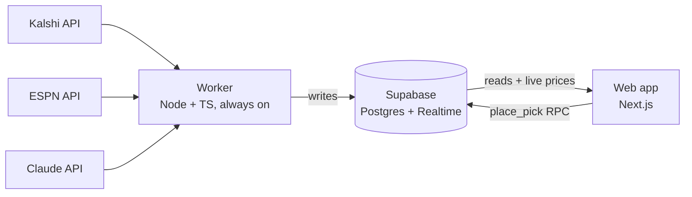

# Storyline

**Every card is a story. Every story has a line.**

Sports prediction markets list thousands of markets a night (props, game lines, team markets, futures), and none of them tell a fan which ones matter or *why*. Storyline **curates** the few worth caring about each day and gives each one a reason: **the right markets, for the right fan, at the right time.**

Storyline is a daily, AI-curated deck of NBA player and team cards built on live [Kalshi](https://kalshi.com) prediction markets. Each card pairs a short "why care" storyline (a hot streak, a revenge game, a backup stepping in for an injured starter) with a single Yes/No market and its live price. You swipe through the deck and make play-money picks. Results come straight from the market.

It's a rebuild of **Units**, a startup I helped found in the DFS era, reimagined for prediction markets: curation and story over volume, for casual fans rather than power bettors.

> **Status:** planning complete, database built and tested, worker ingest running against live data. Built for me and a few friends. Play money only, never real money.

---

## How it works



- **The worker is the only thing that talks to the outside world.** It ingests the slate, polls prices every 30–60s (backing off when rate-limited), runs the daily AI curation, and settles results.
- **The web app only reads from the database**, and Realtime pushes price changes to each open card.
- **Every money movement goes through Postgres functions** that run as single transactions, with row-level security so users can only see their own picks.

## What's interesting here

| Problem | Approach |
|---|---|
| Kalshi rate-limits after a handful of calls | One worker polls once for everyone; clients never call Kalshi ([ADR-003](docs/decisions/003-worker-owns-external-calls.md)) |
| Settling twice must never pay twice | Unique constraints on the ledger make double payouts impossible at the database level ([ADR-006](docs/decisions/006-append-only-ledger.md)) |
| Two fast taps shouldn't spend the same $5 | `place_pick` locks the wallet row for the transaction |
| AI blurbs must not invent stats | Each blurb has to cite a number present in the ESPN context it was given; every run's inputs and outputs are stored for traceability |
| The roadmap includes NFL, contests, team cards, free trades | Structural changes were modeled up front; additive ones deferred ([ADR-010](docs/decisions/010-future-proof-data-model.md)) |

## Repo guide

| Path | What's there |
|---|---|
| [`docs/product.md`](docs/product.md) | **Why Storyline exists:** the problem, the bet, the three product layers, principles, risks |
| [`docs/spec.md`](docs/spec.md) | Product spec: scope, card states, bankroll, resulting, release plan, acceptance criteria |
| [`docs/decisions/`](docs/decisions/) | Architecture decision records: context, options, decision, consequences |
| [`supabase/migrations/`](supabase/migrations/) | Database schema, RLS policies, and functions (`place_pick`, `settle_market`, …) |
| [`supabase/tests/`](supabase/tests/) | Scenario tests, run in CI against Postgres 17 |
| [`worker/`](worker/) | Background jobs (TypeScript). **Ingest** is done: ESPN games and rosters plus Kalshi markets, with player matching. Price polling, curation, and settlement are next. |
| `web/` | *(next)* Next.js app |

## Running it

```bash
# Database tests (Postgres 17 running locally)
PGHOST=localhost PGUSER=postgres ./supabase/tests/run.sh

# Worker
cd worker && npm install
npm test                                   # unit tests
DATABASE_URL=postgres://... npm run ingest # load today's slate
```

## Roadmap

- **v1:** daily curated cards, $5 picks, settlement, My Picks, $100 starting bankroll
- **v1.1:** daily $10 claim, live stat progress on cards, "price moved" confirmation
- **v2+:** login, leaderboard, follow friends, share my picks (with link previews), contests, free trades, where-to-watch, NFL

## How it was built

Planned and built with Claude as a collaborator: I set the product direction and made the calls, and Claude researched the data sources, pressure-tested decisions, and wrote and tested code. The decision records show where the plan changed and why.
